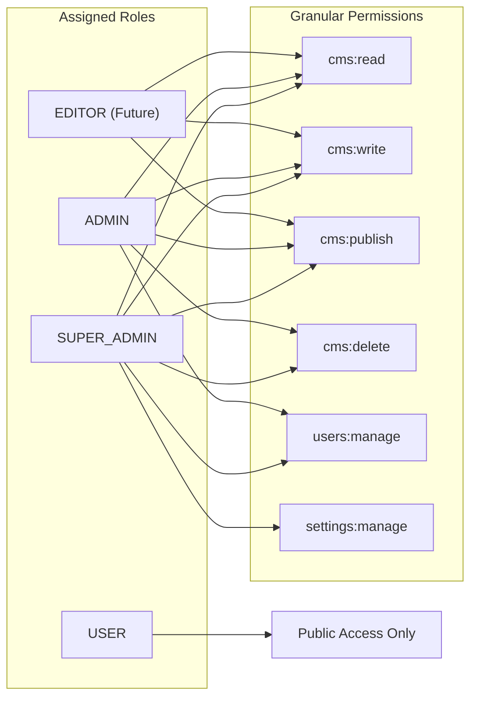

# Dynamic Enterprise CMS & Admin Panel Architecture Plan

## Executive Overview & Frontend Analysis

An in-depth analysis of the Felna Portal frontend reveals five core surface areas that currently rely on static components or simulated mock payloads. To transform this into a robust, real-world CMS, all components will be driven dynamically from the Neon PostgreSQL database with Next.js ISR (Incremental Static Regeneration) and on-demand cache revalidation.

```mermaid
flowchart TD
    subgraph Client_Surfaces ["Public Frontend (Next.js 16 App Router)"]
        TopBar["TopBar (Announcement, Phone, Schedule)"]
        HeroSlider["HeroSlider (Header Text, Badges, Banners)"]
        TrustedPartners["TrustedPartners (Company Logos / Marquee)"]
        BulkSmsOffer["BulkSmsOffer & Marketing (Promotional Long Copy)"]
        BenefitsFeatures["SmsBenefits & WhyChooseUs (Features, Icons)"]
        Footer["Footer & Contact Page (Addresses, Social Links)"]
    end

    subgraph Admin_CMS ["Admin Panel (/admin/cms)"]
        CMSNav["CMS Dashboard Tabs"]
        SiteEditor["Site & Contact Editor"]
        SliderEditor["Hero Slider Manager"]
        PartnerEditor["Partner & Clients Manager"]
        PromoEditor["Promotional Content Editor"]
        SocialEditor["Social Media Manager"]
    end

    subgraph Security_RBAC ["Security & Future RBAC Layer"]
        SessionGuard["Edge Middleware + JWT Verification"]
        RBACMatrix["Capability & Permission Matrix (cms:read, cms:write, cms:publish)"]
        ZodValidator["Zod Input Sanitization & URL Safeguards"]
    end

    subgraph Database_Layer ["Neon PostgreSQL (Prisma 7 ORM)"]
        CmsSiteSettings[("CmsSiteSettings")]
        CmsHeroSlide[("CmsHeroSlide")]
        CmsPartner[("CmsPartner")]
        CmsPromotionalSection[("CmsPromotionalSection")]
        CmsFeatureItem[("CmsFeatureItem")]
        CmsSocialLink[("CmsSocialLink")]
        CmsAuditLog[("CmsAuditLog")]
    end

    Admin_CMS --> Security_RBAC
    Security_RBAC --> Database_Layer
    Database_Layer --> Client_Surfaces
```



---

## 1. Frontend Audit & CMS Entity Mapping

| Frontend Component | Current Hardcoded / Mock Elements | CMS Entity & Fields | Real-World CMS Considerations |
| :--- | :--- | :--- | :--- |
| **TopBar** (`TopBar.tsx`) | Announcement headline, Link text, Link URL, Schedule (`9 am to 6 pm [mon-sat]`), Support link | `CmsSiteSettings`: `announcementText`, `announcementLinkText`, `announcementLinkUrl`, `scheduleText`, `supportPhone` | Must prevent layout break on mobile (<640px) with `truncate` or marquee scroll; link URLs must be validated against `javascript:` injection. |
| **Hero Slider** (`HeroSlider.tsx`) | Slide titles, subtitles, badges, action button links, banner background images | `CmsHeroSlide`: `title`, `subtitle`, `badge`, `imageUrl`, `linkUrl`, `ctaText`, `displayOrder`, `isActive` | **Long Text**: 2–3 sentence value propositions must wrap cleanly with responsive typography (`text-2xl` to `text-6xl`).<br>**Long Image**: Wide banners (16:9 / 21:9) need CSS `object-cover` and container aspect ratio locks to prevent Cumulative Layout Shift (CLS). |
| **Trusted Partners** (`TrustedPartners.tsx`) | Static brand array (Grameenphone, Banglalink, Robi, Teletalk, IGL Group, etc.) | `CmsPartner`: `name`, `logoUrl`, `websiteUrl`, `displayOrder`, `isActive` | Infinite marquee must handle dynamic counts and variable widths seamlessly; fallback gracefully to stylized text badge when no logo image is uploaded. |
| **Bulk SMS Offer** (`BulkSmsOffer.tsx`) | Promo title, long description, promotional badge, image, CTA button | `CmsPromotionalSection` (`sectionKey: "bulk_sms_offer"`): `title`, `description`, `badge`, `imageUrl`, `ctaText`, `ctaUrl` | **Long Text**: Marketing copy can exceed 500+ characters; needs prose container with proper paragraph spacing.<br>**Large Image**: 1:1 or 4:3 card images with Next.js image optimization and placeholder skeleton. |
| **Marketing Section** (`MarketingSection.tsx`) | Title, subtitle, strategy copy, CTA button, preview image | `CmsPromotionalSection` (`sectionKey: "marketing_section"`): `title`, `subtitle`, `description`, `imageUrl`, `ctaText`, `ctaUrl` | Responsive split-grid: image on left/right, fluid text with break-word on small viewports. |
| **SMS Benefits & Why Choose Us** (`SmsBenefits.tsx`, `WhyChooseUs.tsx`) | Accordion items, benefit descriptions, feature cards, icons | `CmsFeatureItem`: `section` ("BENEFIT" \| "WHY_CHOOSE_US"), `title`, `description`, `iconName`, `displayOrder`, `isActive` | Accordion supports lengthy technical explanations; dynamic Lucide icon rendering with safe fallback. |
| **Footer & Contact Page** (`Footer.tsx`, `/contact`) | Phone number (`+880-1958-666999`), Support email (`support@iglweb.com`), Office address, Social links, Sister concern links, Copyright | `CmsSiteSettings` + `CmsSocialLink` + `CmsSisterConcern`: Phone, email, address, working hours, social channels, copyright note | Multi-column responsive layout; phone numbers and email links auto-format with `tel:` and `mailto:`. |

---

## 2. Real-World CMS Challenges & Industry Standard Solutions

### A. Long Text Handling (Copywriting & Translation Resilience)
- **Database Layer**: Unbounded PostgreSQL `Text` columns to prevent 255-character truncation errors.
- **Frontend Layer**:
  - Fluid typography using Tailwind responsive scales (`text-lg sm:text-2xl md:text-4xl`).
  - Word breaking (`break-words`, `hyphens-auto`, `overflow-wrap: break-word`) to prevent long URLs or Bengali Unicode strings from breaking containers.
  - Multi-line clamping with graceful expand/collapse where necessary.
- **Admin Editor**:
  - Live character and word counters with visual guidance (e.g., "Recommended: 50–120 characters for optimal hero readability").
  - Auto-growing multi-line textareas.
  - Live preview cards mirroring the exact production styling.

### B. Long & Variable Image Handling (Aspect Ratios & Performance)
- **Aspect Ratio Locking**:
  - Hero Slider: `aspect-[21/9]` desktop / `aspect-[16/9]` tablet / `aspect-[4/3]` mobile.
  - Partner Logos: Fixed container height (`h-12` to `h-16`) with `object-contain` and centered alignment.
  - Feature Cards: `aspect-[4/3]` or `aspect-square`.
- **Preventing Broken Layouts & CLS**:
  - Blur hash / dark gradient background placeholders while images load.
  - Graceful `onError` image fallback to brand placeholder SVG.
- **Admin Media Management**:
  - Direct Image URL input + support for local file uploads (`/public/uploads/cms`).
  - Instant live image preview with dimension and aspect ratio badge indicator.

### C. Responsiveness & Mobile First CMS Architecture
- **Admin Panel**:
  - Fully responsive drawer navigation on mobile/tablet.
  - Touch-friendly action buttons (min 44x44px touch targets).
  - Sticky bottom save bar with unsaved changes indicator.
- **Frontend Delivery**:
  - Next.js ISR with instant on-demand revalidation (`revalidatePath('/')`, `revalidatePath('/contact')`) upon saving CMS items.

---

## 3. Future-Proof RBAC Architecture

To support role expansion without refactoring database schemas later, we establish a decoupled permission and capability layer:



### Modular Implementation:
1. **Permission Constants** (`src/lib/constants/permissions.ts`):
   Defines `PERMISSIONS` and `ROLE_PERMISSIONS` map.
2. **Access Evaluation** (`src/lib/rbac.ts`):
   - `hasPermission(role, permission): boolean`
   - `requirePermission(permission): Promise<SessionPayload>`
   - `canManageCMS(session): boolean`
3. **Audit Trail** (`CmsAuditLog` table):
   Records who edited what, previous vs new values, and timestamps for enterprise accountability.

---

## 4. Prisma Schema Design

New models integrated cleanly into `prisma/schema.prisma`:

```prisma
// -----------------------------------------------------------------------------
// CMS: Site Settings (Singleton)
// -----------------------------------------------------------------------------
model CmsSiteSettings {
  id                    String   @id @default("default")
  siteName              String   @default("Felna SMS")
  siteTagline           String   @default("Carrier-Grade Bulk SMS & OTP Gateway")
  logoUrl               String?
  announcementText      String   @default("Fast & Reliable Bulk SMS Services.")
  announcementLinkText  String   @default("Join Now")
  announcementLinkUrl   String   @default("/register")
  scheduleText          String   @default("9 am to 6 pm [mon-sat]")
  primaryPhone          String   @default("+880-1958-666999")
  supportEmail          String   @default("support@iglweb.com")
  officeAddress         String   @default("Felna HQ, Dhaka, Bangladesh")
  officeHours           String   @default("Sat - Thu: 9:00 AM - 6:00 PM")
  footerAboutText       String   @db.Text
  copyrightText         String   @default("© Copyright 2007- 2026 IGL Group")
  updatedAt             DateTime @updatedAt
}

// -----------------------------------------------------------------------------
// CMS: Hero Slider Banners
// -----------------------------------------------------------------------------
model CmsHeroSlide {
  id           String   @id @default(cuid())
  title        String   @db.Text
  subtitle     String?  @db.Text
  badge        String?
  imageUrl     String   @db.Text
  linkUrl      String?  @default("/register")
  ctaText      String?  @default("Get Started")
  displayOrder Int      @default(0)
  isActive     Boolean  @default(true)
  createdAt    DateTime @default(now())
  updatedAt    DateTime @updatedAt

  @@index([isActive, displayOrder])
}

// -----------------------------------------------------------------------------
// CMS: Trusted Partners / Companies Worked With Me
// -----------------------------------------------------------------------------
model CmsPartner {
  id           String   @id @default(cuid())
  name         String
  logoUrl      String?  @db.Text
  websiteUrl   String?
  displayOrder Int      @default(0)
  isActive     Boolean  @default(true)
  createdAt    DateTime @default(now())
  updatedAt    DateTime @updatedAt

  @@index([isActive, displayOrder])
}

// -----------------------------------------------------------------------------
// CMS: Promotional Sections (Bulk SMS Offer, Marketing Section)
// -----------------------------------------------------------------------------
model CmsPromotionalSection {
  id          String   @id @default(cuid())
  sectionKey  String   @unique // e.g. "bulk_sms_offer", "marketing_section"
  badge       String?
  title       String   @db.Text
  subtitle    String?  @db.Text
  description String?  @db.Text
  imageUrl    String?  @db.Text
  ctaText     String?
  ctaUrl      String?
  isActive    Boolean  @default(true)
  updatedAt   DateTime @updatedAt
}

// -----------------------------------------------------------------------------
// CMS: Features & Benefits (Accordion & Grid Cards)
// -----------------------------------------------------------------------------
model CmsFeatureItem {
  id           String   @id @default(cuid())
  section      String   // "BENEFIT" | "WHY_CHOOSE_US"
  title        String   @db.Text
  description  String   @db.Text
  iconName     String?  @default("CheckCircle")
  imageUrl     String?  @db.Text
  displayOrder Int      @default(0)
  isActive     Boolean  @default(true)
  createdAt    DateTime @default(now())
  updatedAt    DateTime @updatedAt

  @@index([section, isActive, displayOrder])
}

// -----------------------------------------------------------------------------
// CMS: Social Links
// -----------------------------------------------------------------------------
model CmsSocialLink {
  id           String   @id @default(cuid())
  platform     String   // "facebook", "youtube", "linkedin", "twitter", etc.
  label        String?
  url          String
  displayOrder Int      @default(0)
  isActive     Boolean  @default(true)
  createdAt    DateTime @default(now())
  updatedAt    DateTime @updatedAt

  @@index([isActive, displayOrder])
}

// -----------------------------------------------------------------------------
// CMS: Audit Logs (Enterprise Traceability & Security)
// -----------------------------------------------------------------------------
model CmsAuditLog {
  id        String   @id @default(cuid())
  userId    String
  action    String   // "CREATE", "UPDATE", "DELETE", "TOGGLE_STATUS"
  entity    String   // "HeroSlide", "SiteSettings", "Partner", etc.
  entityId  String
  changes   String?  @db.Text // JSON snapshot
  createdAt DateTime @default(now())

  @@index([entity, entityId])
  @@index([userId])
}
```

---

## 5. Phased Implementation Roadmap

### Phase 1: Database Migration & Seeding
1. Update `prisma/schema.prisma` with the 7 CMS models.
2. Execute `npx prisma db push` to synchronize Neon PostgreSQL.
3. Create `scripts/seed-cms.ts` to populate DB with existing frontend text, images, and partners so zero content is lost.
4. Verify initial database state with an automated test script (`scripts/test-cms-models.ts`).

### Phase 2: Core Validation, RBAC & Service Layer
1. Create `src/lib/constants/permissions.ts` defining granular permissions.
2. Enhance `src/lib/rbac.ts` with `requirePermission()` and `canManageCMS()`.
3. Create `src/lib/validations/cms.ts` with comprehensive Zod schemas protecting against long text overflow, invalid URLs, and XSS risks.
4. Build `src/lib/services/cms-service.ts`:
   - High-performance queries with cached reads (`unstable_cache` / ISR).
   - Resilient fallbacks ensuring the website never renders broken pages.
   - On-demand revalidation trigger (`revalidatePath`).

### Phase 3: Secure CMS API Route Handlers
1. `/api/admin/cms/settings`: GET / PUT for site & contact info.
2. `/api/admin/cms/hero-slides`: GET / POST / PUT / DELETE / REORDER for header banners.
3. `/api/admin/cms/partners`: GET / POST / PUT / DELETE / REORDER for company partners.
4. `/api/admin/cms/promotions`: GET / PUT for Bulk SMS Offer & Marketing blocks.
5. `/api/admin/cms/features`: GET / POST / PUT / DELETE for benefits and Why Choose Us cards.
6. `/api/admin/cms/social-links`: GET / POST / PUT / DELETE for social links.
7. `/api/admin/cms/upload`: Secure image upload handler with file size & MIME type validation.

### Phase 4: Admin Panel UI Development (`/admin/cms`)
1. Create responsive CMS Dashboard layout with tabbed navigation:
   - **Tab 1: Site & Contact Info** (Announcements, Phone, Email, Address, Office Hours).
   - **Tab 2: Hero Slider & Header** (Slide management, Live 16:9 banner preview, reordering, active toggle).
   - **Tab 3: Companies / Partners** (Brand logos/names, infinite marquee preview).
   - **Tab 4: Promotional Blocks** (Bulk SMS Offer & Marketing Strategy copy editor).
   - **Tab 5: Features & Benefits** (Accordion and card items with icon picker).
   - **Tab 6: Social Media Links** (Social channels with instant icon preview).
2. Wire up to `DashboardLayout.tsx` sidebar navigation under "Content & CMS".
3. Implement live preview toggles, character count indicators, and responsive test views.

### Phase 5: Frontend Integration (Connecting Components to DB)
1. Update `src/app/page.tsx` to source all sections from `cms-service.ts`.
2. Connect `TopBar.tsx`, `TrustedPartners.tsx`, `BulkSmsOffer.tsx`, `MarketingSection.tsx`, `SmsBenefits.tsx`, and `WhyChooseUs.tsx`.
3. Update `Footer.tsx` and `src/app/contact/page.tsx` to read dynamic phone numbers, addresses, and social links.

### Phase 6: Test-Driven Verification & Security Audit
1. Run end-to-end automated test suite verifying CRUD operations, RBAC restrictions, and input sanitization.
2. Verify production build (`npm run build`) and responsiveness across all breakpoints.
